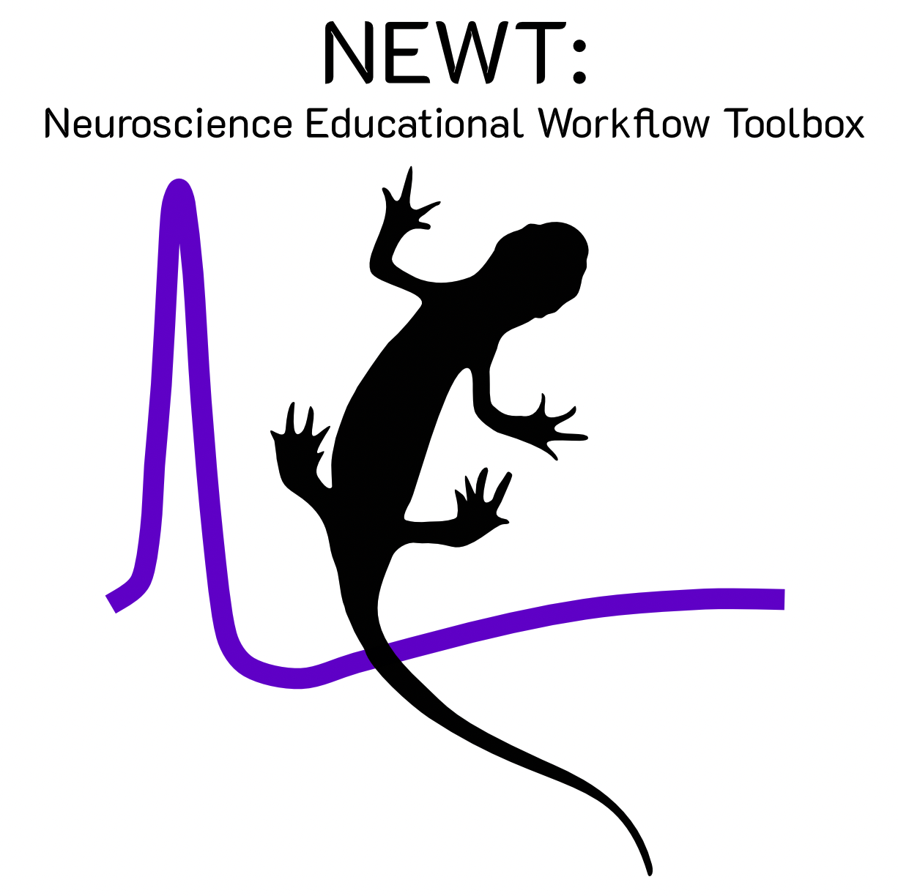

<p align="center"></p>

# NEWT

NEWT, the Neuroscience Educational Workflow Toolbox, is an application designed to visualize recordings from data acquisition systems for students within the University of Washington's undergraduate neuroscience program. Designed for and tested with NI USB-6003 from National Instruments using the NIDAQmx driver. 

Source: [github.com/Neusci-UW/newt](https://github.com/Neusci-UW/newt)

## Why/what?
  
The UW undergraduate neuroscience program has used an A-M Systems 3000 AC/DC Differential Amplifier, a Humbug 60 Hz Noise Eliminator, and an AD Instruments PowerLab 4/26 Digitizer in concordance with LabChart 7 to record and analyze signals recorded from different model organisms. By doing so, students can learn about different information processing modalities in these model organisms to build neurobiology fundamentals. However, this system is dated and difficult to use on different operating systems. NEWT is a flexible Python-based tool to transform signals into a computer-interpretable form, visualize signals, and enables efficient data analysis. This is done by replacing the PowerLab NI USB-6003 and LabChart dependence with NEWT.

## Install
Requires Python 3.11+. For recording, install the
[NI-DAQmx driver](https://www.ni.com/en/support/downloads/drivers/download.ni-daq-mx.html) first.
 
```
git clone https://github.com/Neusci-UW/newt
cd newt
python -m venv .venv
.venv\Scripts\activate          # macOS/Linux: source .venv/bin/activate
pip install -e ".[nidaqmx,dev]"
```
 
## Run
```
newt -c config.toml                        # with the DAQ
newt -c config.toml --backend simulated    # without hardware
```
The old `neusci-daq` command still works.
Edit `config.toml` to set the device, channels, sample rate and scaling.
 
To try review mode with sample data: `python examples/make_demo_session.py demo`, then
**File › Open…** the `demo` folder.

## Features

- **Acquisition**:
  - live multichannel recording, with comments;
  - a Trials browser that sorts recordings into groups by stimulus;
  - overlaid blocks and channels.
- **Stimulator and Protocols**:
  - stimuli and pulse trains, with units;
  - protocols that step a setting and measure each response.
  - **+ Add second output** sends a second stimulus on the other analog output (ao0 and ao1)
    together with the first, from the same clock. Each has its own shape and settings, and a
    protocol can step a setting of either one ("ao1 · Level").
  - Stimuli are limited to ±10 V, the USB-6003's output range. An instructor can set a lower
    limit in the config file: `[stimulator] max_voltage = 5`.
- **Analysis channels** (**+ Analysis channel**, like LabChart's channel calculations): pick a source
  channel and a calculation, or type a formula (Custom formula). Analysis channels can build on each other.
  - Cyclic measurements: rate meter (per second or per minute), period, cyclic height and event count.
  - Filters: low-pass, high-pass, band-pass, band-stop and notch.
  - Moving windows: smoothing, RMS and envelope.
  - Derivative, integral and arithmetic: for example `bandpass(Ch1, 300, 3000)` or `Ch1 - Ch2`.
- **Analysis**:
  - An endless whiteboard of charts that starts empty: students choose every chart and where it goes. Add one with + Add chart or by right-clicking the board, from charts grouped by what runs along their x axis (over the trial, over one cycle, around each spike, sorting spikes, one value per trial), each with the question it answers. A chart's title bar shows only while the mouse is on it, so the board reads as a figure; drag the title to move the chart and its corner to resize it (it snaps to a grid, which can be hidden, and lines up with the others); pan, zoom, and find your way with the minimap. Click a chart to pick it; pick several (shift-click, or drag a box) to resize, line up, restyle or remove them together. Save the board as a layout of your own, and lock it for a class.
  - The Export tool: drag a box over any part of the board to save the plots in it as a figure, at the board's own size: PDF or SVG (vector), PNG or TIFF (at the resolution you pick), or copied to paste into slides or a report.
  - Any chart can be open more than once, each copy with its own name, settings and spike units. Click a chart and its settings show beside the board, with a ? button for an explanation and glossary; number settings are a drag bar with a box to type in. A chart can show the page's groups and spike units or choose its own, to compare Group 3 here with Group 5 there, and has its own look: line thickness, grid lines, and the X and Y ranges (each edge Auto, or typed).
  - A strip on the left folds out what every chart shares: Trials (the browser: tick a group to see its average and a trial to see its trace, everything ticked being what's analyzed; highlight many and Tick highlighted, or Only highlighted; groups can be dragged or sorted by frequency or amplitude), Groups (which groups show, their colors, Spread, and how a group's trials are drawn), Channels (the stimulus and analyzed channels, gains, the stimulus fit) and Spikes.
  - An amplifier gain per channel to divide by, and a fit that cleans up a noisy or coarse recorded stimulus, both applied as data is read: the recordings never change. Trials save the stimulus settings sent, so the known waveform can be lined up with a recording.
  - Finding and sorting action potentials, by itself, in the ticked trials as you tick them (each trial is searched once, and a unit keeps its number and color as more are sorted), with each unit's tick, color and opacity.
  - The spikes found, the units and the measure windows are saved with the session, beside its recordings.
  - Every chart has + and − to zoom and arrows to move, by each axis, while the mouse is over it.
  - Spike charts: overlays and averages, with ± SD or SEM across trials; the stimulus; raster, rate, a PCA map of the units, waveforms, and size and ISI histograms.
  - Response charts: channels and derivatives, PSTH and spike-triggered averages, and stimulus cycles: the repeats overlaid by phase, with a raster per cycle, a phase histogram with vector strength, and a loop of response against stimulus. Charts against time can swap their axes for draggable scale bars.
  - Waveform charts: the action potentials as a phase plot of V against dV/dt, and against time.
- **Saving**: File › Save puts everything in one `.newt` file: the recordings, groups, analysis, layouts and chart settings, the tabs and windows open, the stimulus and protocol, and the simulated network. Opening it (or double-clicking it, with `NEWT.app` on a Mac, made by `python tools/make_mac_app.py`) puts NEWT back as it was (files saved as `.argus`, from before NEWT was renamed, open too). NEWT still records into a working folder, and Save packs it; saving again only adds what changed. NEWT asks before closing if anything has changed since. File › Open Session Folder… and Save Session Folder As… still work with plain folders.
- **Measuring** (the Measure tool, on the board): drag across a chart against time to measure a window of each trial, or, in Phase, across a chart against phase to measure the same part of every stimulus cycle. Windows can be dragged and repeat along the trace. A DataPad table chart holds the measurements (mean, peak, area, slope, frequency, spike count…) per trial, per group average, or as mean ± SD per group, exported as CSV or copied to a spreadsheet; a Scatter chart plots one column against another and fits a curve.
- **Recordings never change**: comments and channel colors edited later are kept beside them, in `trial_edits.json`.
- **Simulation**: a network of up to 10 integrate-and-fire cells with tunable synapses, to practice without an animal.
- **Membrane potential** (under Simulation): ions as particles crossing a membrane through selective
  channels, so the Nernst and GHK potentials and the charge layers on the membrane emerge on their own.
  Tunable concentrations and permeabilities, a scripted action potential, the GHK derivation and a
  GHK calculator. Needs `pip install -e ".[web]"` to show inside the app; otherwise it opens in the
  web browser. For computers without internet, run `python tools/fetch_mathjax.py` once so its
  equations render offline.
- **Files**: opens and saves LabChart `.mat` exports.
- **USB audio and video** (`pip install -e ".[audio]"` for audio):
  - **Setup › Input device** switches to a USB audio interface, a SpikerBox-style device or a
    microphone as the input. Its inputs become channels in1, in2, and so on.
  - **Audio/Video › Listen to** plays a channel through the speakers live, to hear spikes.
  - **Audio/Video › Play** (Space) plays the shown part of a recorded block, with a moving cursor.
  - **Audio/Video › Camera panel** shows a USB camera and records a video with each block. In review,
    the video plays back in step with the traces, and clicking a plot shows that moment.
  - **AmScope microscope cameras** (the MU series, which Windows doesn't list as cameras) appear in
    the same list as "… (AmScope)", through AmScope's own library. Install AmScope's software
    (AmLite) first: Newt uses the `amcam.dll` it installs, or ToupView's `toupcam.dll`. If it's
    somewhere else, set `NEWT_CAMERA_SDK` (or the old `ARGUS_CAMERA_SDK`) to the file's full path. Close AmLite before using the
    camera in Newt: only one program can use it at a time.
  - macOS asks once for permission to use the microphone and camera.

[docs/feature-ideas.md](docs/feature-ideas.md) lists features from LabChart, Spike2, pClamp and
other programs that could come next.

## Who

Made for and by those within UW's neuroscience major!
