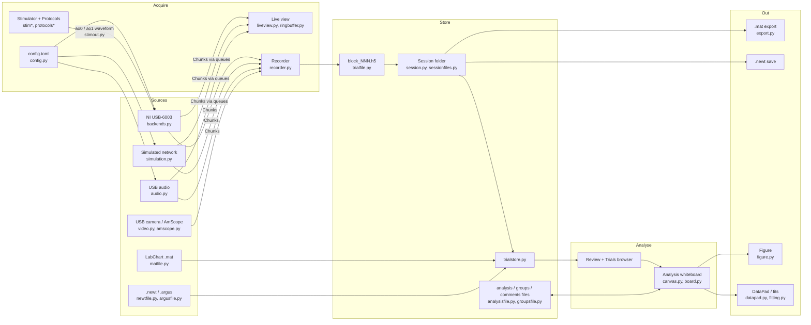
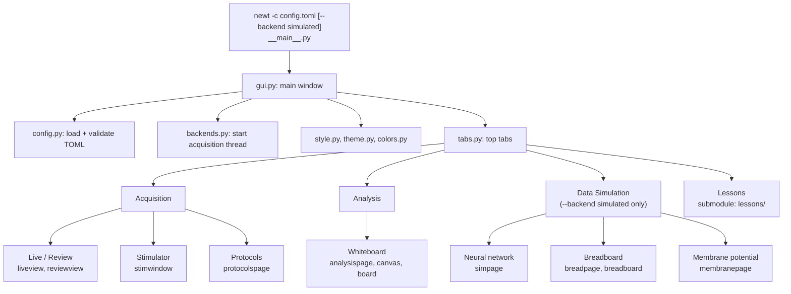
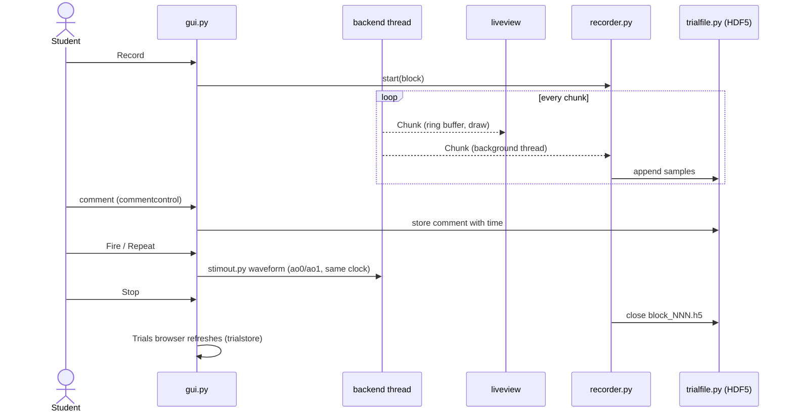
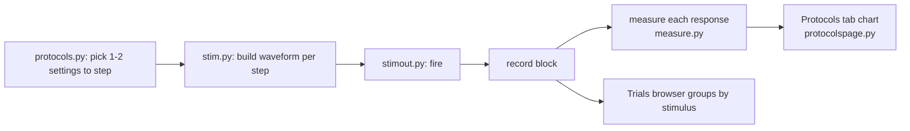
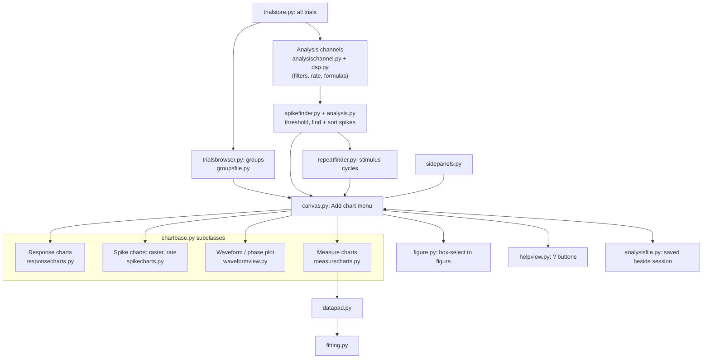
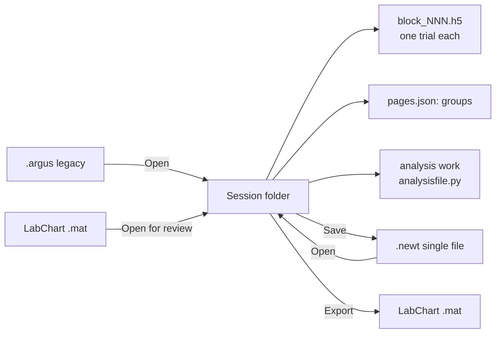

# NEWT process map

Mermaid diagrams (render on GitHub or in any Mermaid viewer). Module names are files in `src/neusci_daq/`.

## 1. Big picture: from signal to figure

## 2. Startup and window structure

Main-window helpers split out of `gui.py`: `mainparts` (shared widgets/modes), `channelsetup` + `channels`, `commentcontrol` + `comments`, `mediacontrol`, `stimcontrol`, `sessionfiles`.

## 3. Recording a trial

## 4. Protocol run (stepping a stimulus setting)

## 5. Analysis pipeline

## 6. Files and formats

## 7. Tooling, tests, docs

| Area | Where |
|---|---|
| Entry points | `newt`, `neusci-daq` → `__main__:main` (pyproject.toml) |
| Mac app bundle | `tools/make_mac_app.py` → `NEWT.app` |
| Demo data | `examples/make_demo_session.py` |
| Tests | `tests/` (run with `.venv/bin/python`) |
| Docs | `docs/feature-ideas.md`, `docs/response-chart-plan.md` |
| Lessons | `src/neusci_daq/lessons` (submodule, Neusci-UW/lessons) |
